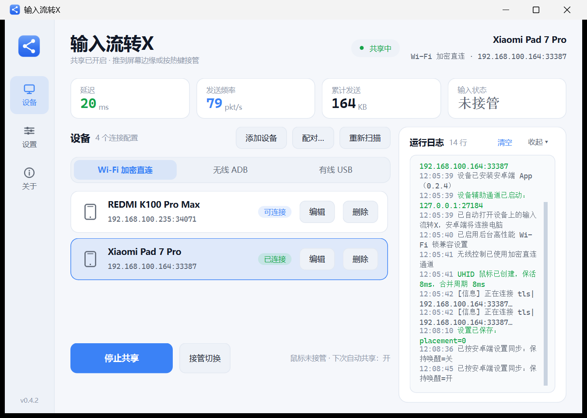
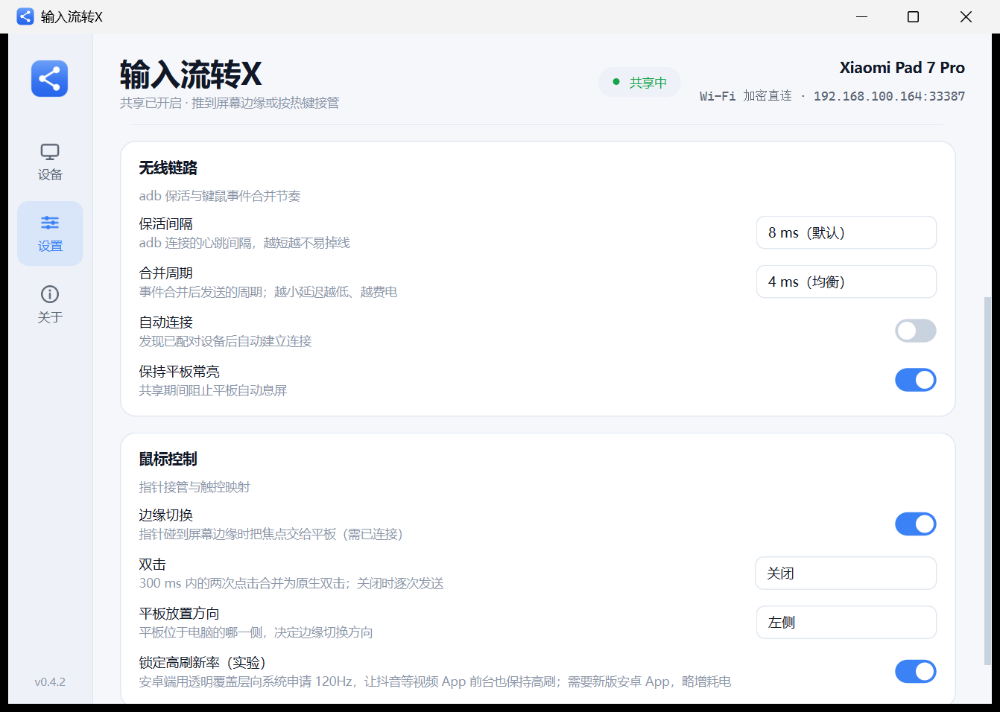
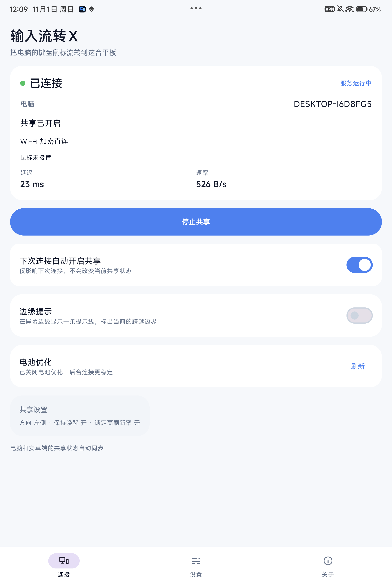

# 输入流转X（inputsharex）

把 Windows 的鼠标和键盘通过 Wi-Fi 流转到 Android 平板/手机：鼠标推到屏幕边缘（或按 `Ctrl+Alt+Q`）即可切到安卓端，反向推回、再按热键都能收回。

安卓端看到的是一个**真实的 USB 鼠标（UHID）**，不是模拟触摸；**不走视频流**，只传控制数据，所以延迟和流量都远低于投屏方案，也不受屏幕分辨率影响。

- 桌面端 **v0.4.4** · 安卓端 **v0.3.0**
- 下载：[Releases](https://github.com/lyf9580/inputsharex/releases/latest)（Windows EXE + 安卓 APK）

| 桌面端设置页 | 安卓端连接页 |
| --- | --- |
|  |  |

## 主要功能

- **键鼠直通**：鼠标移动/按键/滚轮经 UHID 注入安卓；接管期间电脑键盘也能直接在安卓端输入（字母、数字、方向键、数字小键盘、Ctrl+C/Ctrl+V 等组合键），切回电脑时自动释放所有按键。
- **边缘切换**：推到屏幕边缘进入安卓端、反向推回自动收回；支持上下左右四个方向、多显示器和热键切换。收回后光标落在边缘内侧 48px，不会被立刻再次吞掉。
- **扩展屏边缘切换（默认关闭）**：默认只在主显示器上触发边缘切换，避免在扩展屏里正常操作时被误切走；需要时可在设置里打开。
- **二维码配对**：电脑生成二维码，安卓「开发者选项 → 无线调试 → 使用二维码配对设备」扫码即可完成配对并连接；也保留六位配对码方式。
- **连接由电脑端发起**：安卓 App 不自行重连、不开机自启、不会常驻红字报错；连接成功后电脑自动安装/打开安卓端 App。
- **三种连接方式**：Wi-Fi 加密直连（鼠标数据走独立 TLS 通道，ADB 只负责配对和启动）、无线 ADB、有线 USB，分开管理设备。
- **两端配置同步**：放置方向、保持唤醒、锁定高刷新率在两端双向同步，切换设备时以设备端设置为准。
- **剪贴板双向同步**：共享期间电脑复制的文本可在安卓端粘贴，反之亦然（仅纯文本）。
- **两边都能打字**：接管时电脑键盘直接输入安卓端，平板自带的软键盘仍然可用——共享期间临时打开系统的「物理键盘也显示输入法」开关，停止共享或退出时自动还原。
- **方向键切换图文**：可选开关；开启后抖音图文里 `←/→` 变为横向滑动切换图片，关闭时仍是普通方向键。
- **无视频链路**：只传几十字节/事件的 UHID 控制流，不和视频抢 Wi-Fi；空闲时保活以压低延迟长尾。
- **启动检查更新**：两端启动时都会查询 GitHub 最新版本，有更新时提示下载。电脑端下载到程序目录的 `download/`，安卓端用系统下载器保存到公共「下载」目录。
- **自动构建**：GitHub Actions 在每次推送和打标签后自动构建 Windows EXE 与安卓 APK，标签构建会直接附到 Release。

## 快速开始

1. 从 [Releases](https://github.com/lyf9580/inputsharex/releases/latest) 下载 `InputShareX.exe` 和安卓 APK；安卓端安装 APK，电脑双击 EXE（单文件，无控制台窗口，常驻托盘）。
2. 安卓端打开「开发者选项 → 无线调试」，与电脑连接同一个 Wi-Fi。
3. 电脑点「配对…」，默认显示二维码：安卓端进入「无线调试 → 使用二维码配对设备」扫码即可；也可切到「配对码配对」手动填写 IP、端口和六位配对码。
4. 回设备页点一下设备卡片发起连接（电脑会自动安装/打开安卓端 App）。
5. 推屏幕边缘或按 `Ctrl+Alt+Q` 把鼠标交给安卓端；反向推回或再按一次热键收回。关闭窗口会收进托盘，托盘菜单可开始/停止共享、切换接管和退出。

> 设置页的「安卓端放置方向 / 保持唤醒 / 锁定高刷新率」与安卓端双向同步，任一端修改另一端即时更新。

## 已知限制

- 无线链路仍有偶发长尾（AP 调度、省电策略等），追求绝对稳定请用 USB。
- 「锁定高刷新率」用 1×1 覆盖层持续渲染，部分机型 GPU 占用明显升高，可按需关闭。
- 键盘流转只在鼠标接管期间生效；键盘顶部的多媒体/功能键不转发，滚轮尚未逐项验收。
- 剪贴板仅同步纯文本，图片、文件、富文本不支持。
- 边缘切换依赖系统 `dumpsys input` 的设备状态与坐标，不同 ROM/Android 版本格式可能不同（Android 16 单行、Android 17 多行已适配）。
- 目前主要在 Xiaomi Pad 7 Pro（Android 16）和 REDMI K100 Pro Max（Android 17）上自测，其它机型未逐一验证。
- 部分 MIUI 机型在 APK 覆盖安装后会重置「显示在其他应用上层」权限，需要重新授权。

## 说明

- `vendor/scrcpy-server.jar` 来自 [Genymobile/scrcpy](https://github.com/Genymobile/scrcpy) v3.3.3（Apache-2.0），仅作为设备端代理使用。
- 本项目为独立重写，不包含原版应用任何代码，仅参考其公开行为（配置项、端口、交互模式）以保持兼容。

## 开源许可

本项目以 [Unlicense](LICENSE) 协议发布，进入公有领域：可自由使用、修改、分发和商用，无需署名。
