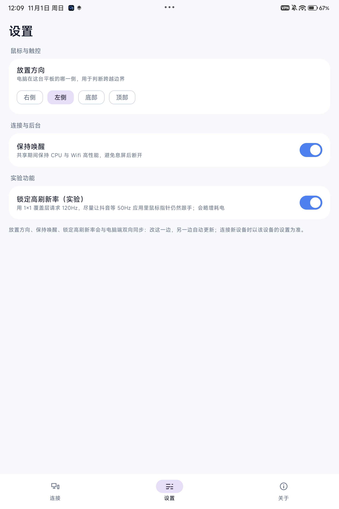

# 输入流转X（inputsharex）

用 Python + Kotlin 重新实现的「输入流转」：把 Windows 的鼠标（以及部分键盘能力）通过 Wi-Fi 共享给 Android 平板 / 手机。
设备端看到的是一个**真实的 USB 鼠标（UHID）**，不是注入的触摸事件；**不走视频流**，只传控制数据，因此延迟和流量都远低于投屏方案。

- 当前版本：桌面端 **v0.4.2**，安卓端 **v0.2.4**
- 发布页：[Releases](https://github.com/lyf9580/inputsharex/releases/latest)（Windows EXE + 安卓 APK）
- 个人项目，不依赖原版闭源应用（原版是 MSIX + Nuitka 编译的桌面程序），这里是干净重写。


| 桌面端设置页 | 安卓端连接页 |
| --- | --- |
|  |  |



## 组成

| 部分 | 位置 | 说明 |
| --- | --- | --- |
| 桌面端 | Release：`InputShareX.exe`（约 59 MB 单文件） | PySide6 GUI，深浅色主题，托盘常驻，无控制台窗口 |
| 安卓端 | Release：`inputsharex-android-0.2.4.apk`（约 9.6 MB） | Kotlin + Jetpack Compose；前台服务、WifiLock、边缘提示、1×1 高刷覆盖层（可关） |
| 引擎 | `src/inputsharex/` | scrcpy 控制通道 + UHID 鼠标 + 相对捕获 + 保活；运行时不依赖第三方库 |
| 构建 | `build-desktop.ps1`、`tools/control-relay/build.ps1`、`android/` | PyInstaller onefile、Java relay、Gradle APK |

## 快速开始

1. 从 [Release](https://github.com/lyf9580/inputsharex/releases/latest) 下载 `InputShareX.exe` 和安卓 APK；平板安装 APK，电脑双击 EXE。
2. 平板打开「开发者选项 → 无线调试」，并与电脑连同一个 Wi-Fi。
3. **首次连接先配对**：电脑点「配对…」，默认是二维码页 —— 平板进入「无线调试 → 使用二维码配对设备」扫码即可；
   也可以切到「配对码配对」，填平板显示的 IP:端口 + 6 位配对码。
4. 回设备页点一下设备卡片发起连接。连接成功后：
   - 若平板没有装 App，电脑会先把 Release 内置的 APK 装上；
   - 然后电脑通过 adb 自动打开平板上的 App，并让它连接电脑（App 平时不会自己重连，也不会开机自启）；
   - 共享按平板上的「下次连接自动开启共享」决定，也可以手动点「开始共享」。
5. 把鼠标交给平板：推到当前显示器的边缘（方向由设置里的「平板放置方向」决定），或按 **Ctrl+Alt+Q**。
   反向推到平板边缘会自动收回；再按一次热键也能收回（收回后光标落在边缘内侧 48px，不会被立刻再次吞掉）。
6. 关窗口 = 收进托盘；托盘菜单可开始/停止共享、接管切换、退出。

> 设置页的「平板放置方向 / 保持唤醒 / 锁定高刷新率」与安卓端**双向同步**：任一端修改，另一端即时更新；
> 切换设备连接时，以设备端的设置为准。
> 旧版的「边缘死区」已移除：两端算法都不再使用它（之前调了也不会生效），所以直接删掉。

## v0.4.x 主要变化

- **二维码配对**：电脑生成二维码，平板在「无线调试 → 使用二维码配对设备」扫码；保留配对码方式。
- **连接只由电脑端发起**：安卓 App 不再自行重连、不再开机自启、不再显示红字报错；电脑连接成功后自动拉起 App。
- **自动检测/安装安卓端 App**：未安装时用内置 APK 自动安装。
- **两端设置双向同步**：放置方向、保持唤醒、锁定高刷新率；`保持唤醒` 现在真正控制 WakeLock。
- **键盘流转**：鼠标接管期间，电脑键盘直接在安卓端输入（字母、数字、方向键、数字小键盘、Ctrl+C/Ctrl+V 等组合键）；切回电脑时自动释放所有按键。
- **安卓 17 边缘返回修复**：指针探针适配 `mDeviceStates` 的多行 `DeviceId(id):[...]` 格式，手机上也能推边缘回电脑。
- **热键收回不再被立即重吞**：disarm 后光标移到边缘内侧 48px。
- **停止/重开后鼠标卡住修复**：每实例唯一窗口类、生命周期串行、会话健康检查。
- **UI 改版**：指标卡上移、运行日志固定右侧、分段式传输切换、侧栏图标居中。
- 修复二维码配对窗口「一打开就提示已取消配对」。

## 为什么比投屏跟手

1. **无视频链路**：只传几十字节/事件的 UHID 控制流，不和视频抢 Wi-Fi。
2. **链路保活**：空闲时每 8 ms 发一条零位移 UHID 报文，避免 Wi-Fi DTIM 把下行稀疏包缓冲到下一拍（ping p50 从 22–50 ms 降到 10–13 ms）。
3. **合并发送**：鼠标移动在内存累加，按 `cadence_ms` 合并成一帧 `sendall`（无线路径实际下限 8.33 ms），配合 `TCP_NODELAY`。
4. **大位移不丢帧**：单拍最多 8 个 HID 报文、每报文位移上限 120，残余留到下一拍继续。
5. **1 ms 定时器**：`timeBeginPeriod(1)` + 发送线程 `THREAD_PRIORITY_HIGHEST`。
6. **UHID 相对位移直通**：不做浮点二次累积，避免小位移被量化丢失。

实测数据（Xiaomi Pad 7 Pro / Android 16 / Wi-Fi 6 5GHz ch149，MT7922）：

| 指标 | 数值 |
| --- | --- |
| 辅助通道 RTT（同机计时） | 2–3 ms |
| 引擎注入延迟（250 Hz 位移） | p50 1.8–2.1 ms / p95 3.8–4.1 ms / max ≈4.5 ms |
| 链路 ping（开启保活） | p50 10 ms / p90 ~56 ms / max ~116 ms |
| 链路 ping（完全空闲，对照） | p50 22–50 ms / p90 78–122 ms / max 105–214 ms |
| USB 直连（对照） | 1–2 ms |

> Wi-Fi 空口仍有 50–120 ms 级长尾（AP 调度、省电策略等），这是无线方案绕不开的物理下限；追求稳定低延迟就用 USB。

## 构建

```powershell
python -m venv .venv
.venv\Scripts\pip install -e .

# Java relay（修改 tools/control-relay 下的 Java 后执行）
.\tools\control-relay\build.ps1

# 安卓 App（需要 JDK 17 + Android SDK）
.\android\gradlew.bat -p android :app:assembleDebug
copy android\app\build\outputs\apk\debug\app-debug.apk vendor\inputsharex-android.apk

# 桌面 EXE（PyInstaller onefile）
.\build-desktop.ps1 -Shortcut
```

> 构建 EXE 需要 `vendor/inputsharex-android.apk`：它不进 git（构建产物），从 Release 下载，或自己构建 APK 后拷到 `vendor/`。

## 目录

```
src/inputsharex/    桌面引擎与 GUI
  adb.py            adb 封装（devices/forward/reverse/push/shell，自带 TEMP 重定向）
  server.py         scrcpy-server 生命周期（推送、转发、启动、握手、端口顺延）
  direct.py         TLS 加密直连凭据与 relay 进程管理
  session.py        控制会话（合并发送、1 ms 定时器、保活、延迟统计）
  capture.py        Windows 相对鼠标捕获（Raw Input + ClipCursor，ctypes）
  link.py           设备辅助通道（adb reverse + JSON 行协议）
  pairing.py        二维码配对协议（WIFI:T:ADB，_adb-tls-pairing/_adb-tls-connect）
  androidapp.py     安卓端 App 检测/安装/拉起
  app.py            Qt 控制器（发现/连接/共享/接管/配置同步/统计）
  cli.py            命令行入口（auto/run/probe/devices/diag）
  gui.py            桌面 GUI 入口
  ui/               PySide6 界面（主窗口/组件/主题/托盘/配对框）
tests/              单元测试（52 项，不含 GUI 窗口回归）
tools/control-relay TLS relay + 指针探针（Java，构建成 vendor/inputsharex-relay.jar）
tools/diagnostics   链路抖动/场景诊断脚本
android/            安卓 App（Kotlin + Compose，前台 LinkService）
desktop/            PyInstaller 入口、图标、启动脚本
docs/               架构、协议、逆向笔记、截图
vendor/             scrcpy-server.jar、platform-tools(adb)、relay jar
```

## 已知限制

- 无线抖动有物理下限（见上）；要绝对稳定请用 USB。
- 「锁定高刷新率」是 1×1 覆盖层 + `setFrameRate(120)`：对抖音这类会把面板降到 50 Hz 的应用有改善，
  但实测会显著抬高 GPU 合成负载（本机 surfaceflinger 85% → 关闭后 7%）。如果觉得发热或卡顿，可在安卓设置页关闭。
- 部分 MIUI 机型在 APK 覆盖安装后会重置「显示在其他应用上层」权限，需要重新授权覆盖层。
- 键盘流转只在鼠标接管期间生效：支持字母、主键盘数字、方向键、编辑键、F1–F12、数字小键盘与 Ctrl/Shift/Alt/Win 组合；键盘顶部的多媒体/功能键不转发，滚轮/剪贴板尚未逐项验收。
- 边缘切换依赖系统 `dumpsys input` 的设备状态与坐标：不同 ROM / Android 版本格式可能不同（Android 16 单行、Android 17 多行已适配）。
- 主要在 Xiaomi Pad 7 Pro（Android 16）与 REDMI K100 Pro Max（Android 17）上自测，其它机型未逐一验证。

## 路线图

- [x] v0.1 控制通道 + UHID 鼠标 + 保活
- [x] v0.1.1 一键启动（mDNS 自动发现）、自带 adb、端口顺延
- [x] v0.2 合并发送 + 设备辅助通道
- [x] v0.3 桌面 GUI + 安卓 App + 双端优化
- [x] v0.3.x 边缘切换、多显示器、保活幂等、光标隐藏/恢复
- [x] v0.4 二维码配对、连接电脑端发起、自动安装安卓端、配置双向同步、安卓 17 边缘修复、UI 改版、键盘流转
- [ ] 滚轮全量验收、剪贴板同步
- [ ] 多设备配置记忆、按键映射
- [ ] 安装包与自动更新

## 说明

- `vendor/scrcpy-server.jar` 来自 [Genymobile/scrcpy](https://github.com/Genymobile/scrcpy) v3.3.3（Apache-2.0），仅作为设备端代理使用。
- 本项目不包含原版应用任何代码，仅参考其公开行为（配置项、端口、交互模式）作为兼容参考。
- 更多文档：[架构说明](docs/ARCHITECTURE.md)、[辅助通道协议](docs/LINK_PROTOCOL.md)、[原应用逆向笔记](docs/REVERSE_NOTES.md)。
